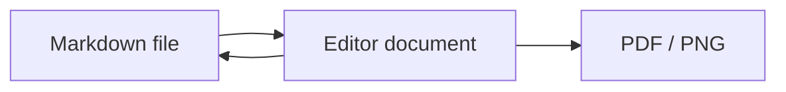

# Welcome to UltraNote

This sample note only loads when the editor runs outside the app (`pnpm dev`). Edits are logged to the console instead of saved.

## Text

Some **bold**, *italic*, ~~struck~~ and `inline code`, a [link](https://example.com/docs_page) and a bare URL: https://example.com/some_path. Identifiers like snake_case_name and comparisons like a < b & c > d stay as they are.

> A quote, with a second line
> joined into the same paragraph.

## Lists

- First item
- Second item
  - Nested item
    - Deeper item
- Third item

1. One
2. Two
   1. Two point one

- [x] Write the adapter
- [ ] Wire the bridge
  - [ ] Nested to-do

## Table

| Feature | Status | Notes |
| :--- | :---: | ---: |
| Tables | done | alignment kept |
| Pipes | done | a \| b |

## Code

```ts
function greet(name: string): string {
  return `Hello, ${name}!`
}
```



```mermaid
graph TD
  A --> 
```

---

Click a diagram to edit its source. The last one is broken on purpose to show the error state.
