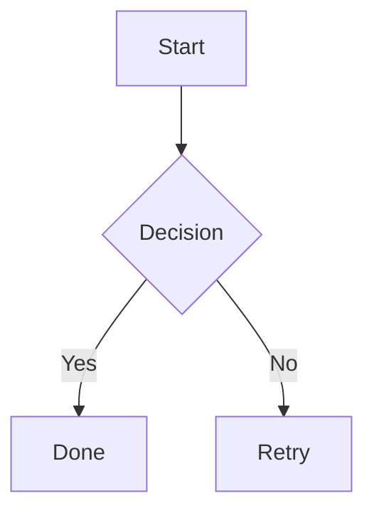

# What the slash menu inserts

Each block below is exactly what an editor command writes, so a note made only with the menus reopens unchanged.

## Heading 2

### Heading 3

- Bullet

1. Numbered

- [ ] To-do

|  |  |  |
| --- | --- | --- |
|  |  |  |
|  |  |  |

```
```



> Quote

---


