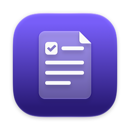
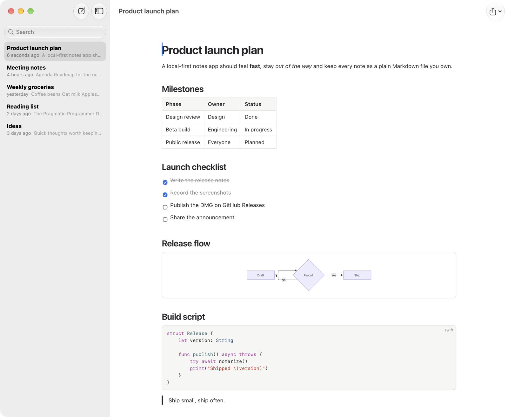
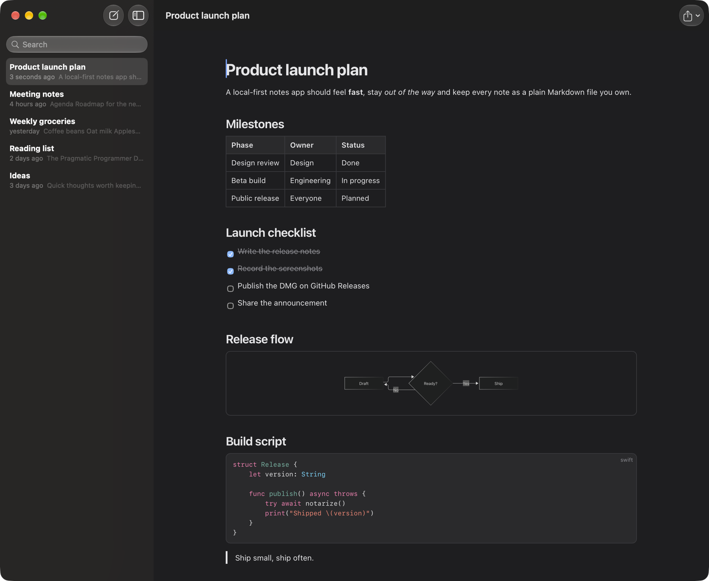
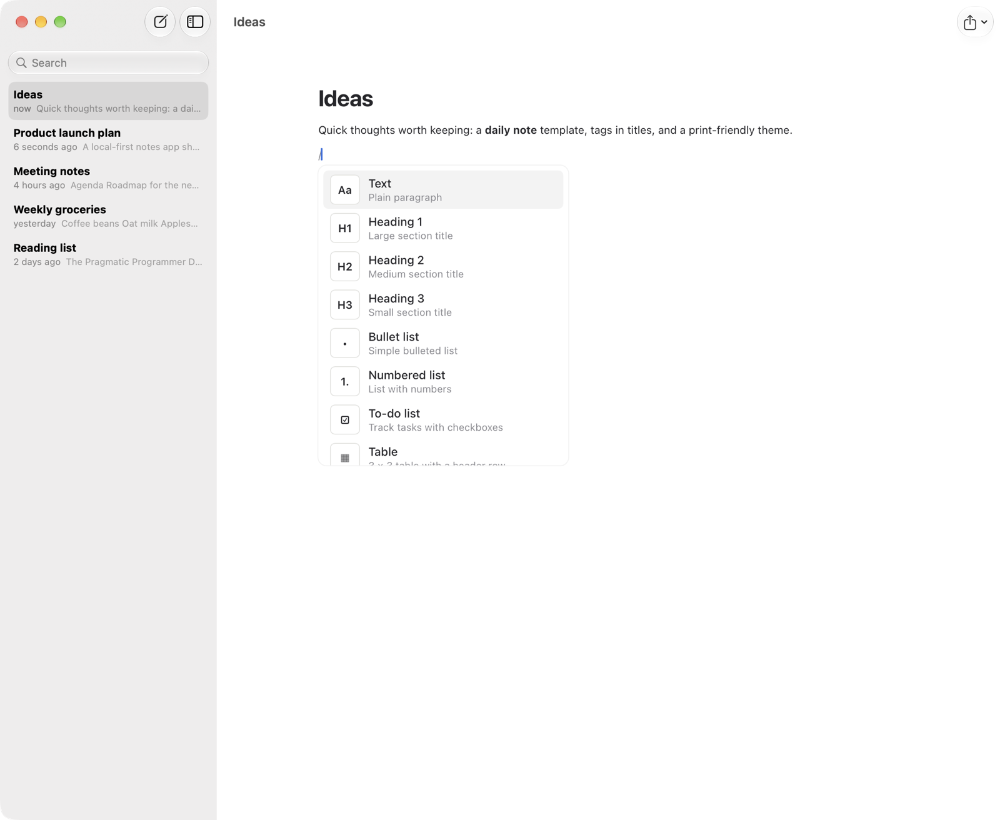
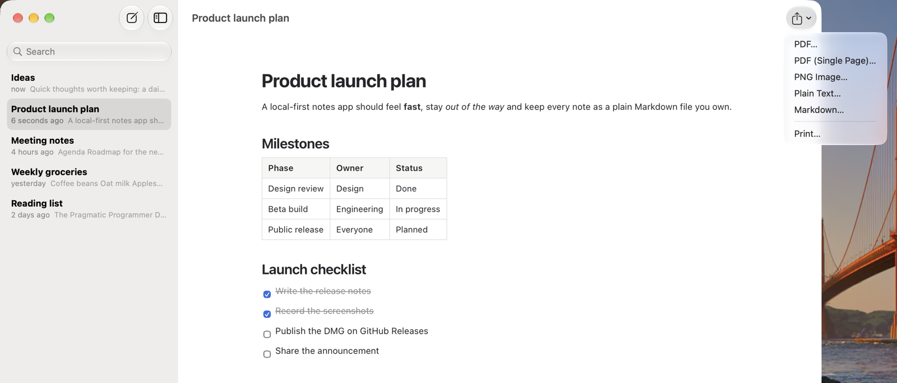
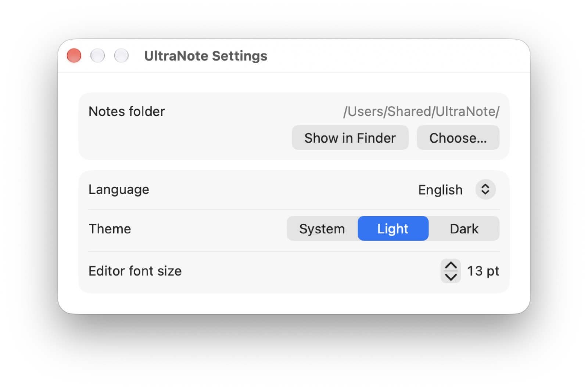

<div align="center">



# UltraNote

**A fast, local-first notes app for the Mac. Every note is a plain Markdown file you own.**

[](#requirements)
[](#requirements)
[](https://www.swift.org)
[](https://github.com/christiancuri/ultranote/releases/latest)
[](LICENSE)



</div>

## Download

**[Download the latest release](https://github.com/christiancuri/ultranote/releases/latest)**: open the `.dmg` and drag UltraNote to Applications.

- Signed with a Developer ID and notarized by Apple, so it opens without Gatekeeper warnings.
- Updates itself through [Sparkle](https://sparkle-project.org), checking for a new version every hour. Turn automatic checks off in Settings, or use **UltraNote › Check for Updates…** at any time.
- Your notes live in `~/Documents/UltraNote` until you pick another folder in Settings.

### Requirements

macOS 26 (Tahoe) or later on an Apple Silicon Mac (M1 or newer).

## Features

- **Plain Markdown on disk.** One `.md` file per note in a folder you choose; images go to its `attachments/` folder. Open, sync or back up your notes with any tool. Edits save automatically, and changes made by other apps appear right away.
- **A rich editor that stays out of the way.** Headings, bold, italic, strikethrough, inline code, links, bulleted, numbered and to-do lists, quotes, dividers and tables. Markdown shortcuts work as you type (`# `, `- `, `[ ] `, `` ``` ``).
- **Slash menu.** Type `/` on an empty line to insert any block: text, headings, lists, a to-do list, a table, a code block, a quote, an image or a diagram.
- **Code blocks** with syntax highlighting for common languages.
- **Mermaid diagrams.** Write a flowchart, sequence diagram or chart in a `mermaid` block and see it rendered in place.
- **Images.** Paste or drop images into a note.
- **Search and find.** Filter every note from the sidebar search, and find inside the open note with ⌘F.
- **Export and print.** PDF (paginated or one long page), PNG, plain text or Markdown, print, or copy the note as Markdown.
- **Light and dark.** Follows the system or a theme you pick, with an adjustable editor font size. The interface is in English or Brazilian Portuguese.

<table>
  <tr>
    <td width="50%"></td>
    <td width="50%"></td>
  </tr>
  <tr>
    <td align="center"><sub>Dark theme</sub></td>
    <td align="center"><sub>Type <code>/</code> to insert any block</sub></td>
  </tr>
  <tr>
    <td></td>
    <td></td>
  </tr>
  <tr>
    <td align="center"><sub>Export to PDF, PNG, text or Markdown</sub></td>
    <td align="center"><sub>Settings</sub></td>
  </tr>
</table>

## Keyboard shortcuts

| Shortcut | Action |
| --- | --- |
| ⌘N | New note |
| ⌘F / ⌘G / ⇧⌘G | Find in note, next, previous |
| ⌘P | Print |
| ⌥⇧⌘C | Copy as Markdown |
| ⌘B / ⌘I / ⇧⌘X / ⌘E | Bold, italic, strikethrough, inline code |
| ⌘K | Link |
| ⌥⌘0 / ⌥⌘1 / ⌥⌘2 / ⌥⌘3 | Body text, heading 1, 2, 3 |
| ⇧⌘8 / ⇧⌘7 / ⇧⌘9 | Bulleted, numbered, to-do list |
| ⌥⌘C | Code block |
| ⇧⌘B | Quote |
| ⌘Z / ⇧⌘Z | Undo, redo |
| ⌘, | Settings |

Every block, including tables, diagrams and images, is also in the **Format** menu.

## Privacy

UltraNote is local-only. Your notes never leave your Mac: there is no account, no cloud service, no analytics and no telemetry. The only network request the app makes on its own is the hourly update check against this repository's GitHub Releases, which you can turn off in Settings. Links in your notes open in your browser.

## Build from source

Requirements: Xcode 26, [XcodeGen](https://github.com/yonaskolb/XcodeGen), [SwiftLint](https://github.com/realm/SwiftLint) and [pnpm](https://pnpm.io) (for the editor bundle).

```sh
brew install xcodegen swiftlint pnpm
echo "<your team id>" > .team-id   # gitignored; or export TEAM_ID
make run
```

The Makefile reads the team id and never prints it.

| Command | What it does |
| --- | --- |
| `make gen` | Generate `UltraNote.xcodeproj` from `project.yml` (the project is not committed) |
| `make editor` | Build the web editor bundle (Vite) into `build/editor` |
| `make build` | `editor`, `gen`, then a signed Debug build (arm64) into `build/DerivedData` |
| `make run` | `make build`, then open the app |
| `make test` | The `UltraNoteKit` test suite (`swift test`) and the editor's `vitest` suite |
| `make lint` | `swiftlint lint --strict` and the editor's `tsc --noEmit` |
| `make sparkle-key` | Create (first use) and print the Sparkle EdDSA public key |
| `make clean` | Remove `build/`, the generated project and the package build |

Debug builds accept `ULTRANOTE_NOTES_DIR=<folder>` to use a scratch notes folder instead of your real one, and a `--self-test <dir>` switch that loads the editor, round-trips a fixture note and exports every format.

Logs use the subsystem `dev.christiancuri.ultranote`:

```sh
log stream --info --predicate 'subsystem == "dev.christiancuri.ultranote"'
```

## Project structure

```
UltraNote/               The app (SwiftUI + AppKit)
  App/                   Entry point, AppDelegate, models, menus, export, debug hooks
  MainWindow/            Sidebar, editor host and find bar
  Settings/              Settings window
  Updates/               Sparkle updater
  SelfTest/              Debug-only end-to-end self-test
Packages/UltraNoteKit/   All Swift logic and its tests
  EditorBridge           The Swift <-> JavaScript contract (messages, calls, URL policy)
  EditorHost             WKWebView host, app:// scheme handler, async editor API
  ExportKit              PDF, PNG, text and Markdown export
  NotesCore              Notes on disk, titles and file names, search, folder watching
Editor/                  The web editor (Vite + TypeScript + React + TipTap)
Branding/                Icon sources, DMG background and volume icon
scripts/                 release.sh, publish.sh, sparkle-tools.sh
project.yml              XcodeGen spec
```

## Releasing

Releases are tagged `v<x.y.z>` and published as GitHub Releases. The build number is the commit count, so it always grows.

```sh
make release VERSION=0.2.0              # signed, notarized and stapled DMG + zip + checksums in build/release/dist
make publish VERSION=0.2.0 DRY_RUN=1    # preview the whole publish without building or uploading
make publish VERSION=0.2.0              # build, extend the Sparkle appcast, tag, push and create the release
```

Before publishing, add a `## 0.2.0` section to [`CHANGELOG.md`](CHANGELOG.md): it becomes both the GitHub Release notes and the Sparkle update notes. `make publish` runs on a clean `main` that matches `origin/main`.

Every release carries the full Sparkle appcast (`appcast.xml`, all versions, newest first) as an asset, so the app's feed is always `https://github.com/christiancuri/ultranote/releases/latest/download/appcast.xml`. Each item points at that version's DMG and is signed with the EdDSA key.

One-time setup:

- A Developer ID signing identity for your team (`TEAM_ID` or `.team-id`). Xcode's cloud-managed signing works.
- A notarytool keychain profile named `apple-notary` (`xcrun notarytool store-credentials apple-notary ...`). Override it with `NOTARY_PROFILE`.
- The Sparkle EdDSA key in the login keychain under the account `ultranote`. `make sparkle-key` prints the public key (`SUPublicEDKey` in `project.yml`) and creates the key on first use. Back up the private key safely: without it, existing installs can't verify new updates.

See [`scripts/release.sh`](scripts/release.sh) and [`scripts/publish.sh`](scripts/publish.sh) for every step and environment variable.

## Acknowledgements

- [TipTap](https://tiptap.dev) and [ProseMirror](https://prosemirror.net) for the editor.
- [Mermaid](https://mermaid.js.org) for diagrams and [lowlight](https://github.com/wooorm/lowlight) for syntax highlighting.
- [Sparkle](https://sparkle-project.org) for updates.
- [XcodeGen](https://github.com/yonaskolb/XcodeGen) and [SwiftLint](https://github.com/realm/SwiftLint).

## License

[MIT](LICENSE) © Christian Curi
